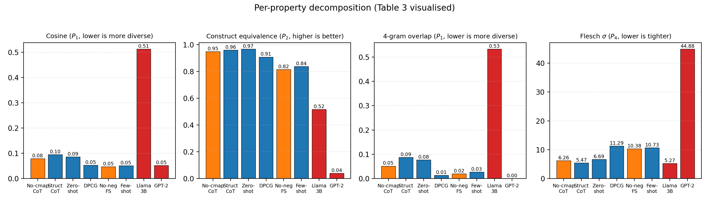

# VARIA: Benchmarking Frontier LLMs on Construct-Equivalent Assessment Variant Generation

**Dr. Ernesto Lee**
Miami Dade College
elee@mdc.edu

# Abstract

**In plain terms:** if we are going to let AI write personalized versions of tests for every student, those versions have to be more than surface paraphrase — they have to look genuinely different on the outside while still measuring the same underlying skill on the inside. This paper asks whether today's frontier AI models can actually do that, and offers a way to measure it.

AI-Integrated Authentic Assessment (AIAA) frameworks propose to replace surveillance-based proctoring with per-student task variation: each examinee receives a unique-yet-equivalent performance task, making answer copying useless without invasive monitoring. The framework's no-surveillance integrity guarantee is conditional on a presumed but unverified capability — that large language models can generate parallel variants of an assessment blueprint that are simultaneously surface-distinct, construct-equivalent, rubric-applicable, and difficulty-matched. We introduce VARIA, a benchmark that operationalises this presumption as four measurable properties of a generated variant set. VARIA evaluates three frontier model families (Anthropic Claude Opus 4.7, OpenAI GPT-5.5, Google Gemini 3.1 Pro Preview) across four prompting strategies (zero-shot, few-shot with anchor examples, structured chain-of-thought, dimension-preserving constrained generation) on three competency-based blueprints drawn from applied AI and data analytics, alongside two non-frontier reference systems (a small open instruction-tuned model and GPT-2 small) and two targeted ablations. A pilot of 600 generated variants across 60 condition cells reveals that frontier strategies cluster tightly on a composite integrity score at the strategy level (joint $\mathcal{J} \in [0.81, 0.88]$ on strategy means; individual model-strategy cells span $0.70$–$0.90$) while the non-frontier references collapse to $\mathcal{J} \in [0.50, 0.55]$ — a twenty-five to thirty-one percentage-point gap between the capability tiers that establishes the benchmark's discrimination (exact permutation $p = 0.005$, the design's floor). Within the frontier band, structured chain-of-thought and zero-shot prompting maximise construct equivalence; dimension-preserving constrained generation and few-shot anchoring maximise surface diversity; and the two regimes trade against each other on readability parity — a trade-off that exact paired tests on the matched cells support in all three directions for few-shot anchoring ($p = 0.004$ each). Under illustrative property thresholds, no strategy passes all measured properties in every cell. We release VARIA together with a ready-to-run follow-up harness (per-variant cross-family judging, the full rubric-stability protocol, a held-out distant-discipline blueprint), recommend a generation protocol keyed to the deploying institution's threat profile, and pre-register a follow-up that will measure rubric stability and behavioural copy-resistance.

# 1. Introduction

The arrival of fluent generative language models has destabilised a core assumption of high-stakes educational assessment: that what a student produces under examination conditions reflects what that student can produce unaided. Conventional remedies — proctoring, lockdown browsers, biometric surveillance — escalate intrusiveness without resolving the underlying problem, since generative tools are now ambient on personal devices and in collaborative chats [@kasneci2023chatgpt; @yan2023practical]. A growing literature on authentic assessment proposes a different solution: rather than policing the examination room, redesign the assessment so that copying is structurally useless [@salinasnavarro2024generative; @brown2020educause]. The proposal at the heart of this redesign is variation-at-scale: each examinee receives an instance of a single competency blueprint, instantiated with different surface details — domain, scenario, jargon, reading register — such that no two students can productively share answers. The AIAA framework explicitly delegates the generation of these variants to large language models [@chen2020artificial; @gligorea2023adaptive], and recent course-design proposals have begun to operationalise the idea in working classrooms [@mennella2024ethical; @holmes2021ethics].

The framework's integrity claim, however, is conditional on an unverified capability. If LLMs cannot generate variants that are surface-distinct yet construct-equivalent, rubric-applicable, and difficulty-matched, then variation-at-scale is a fig leaf and the no-surveillance guarantee collapses. Despite the speed with which AIAA-style proposals have been adopted in higher-education guidance [@yan2023practical; @holmes2021ethics], the capability presumption underlying them has not been directly benchmarked. Existing work on automatic item generation in psychometrics is dominated by template-based methods for multiple-choice items with closed-form answer keys, which sidestep the rubric-applicability problem that defines open-response performance assessment [@panadero2023effects; @fenn2020development]. LLM evaluation benchmarks measure model competence on fixed items rather than the inverse problem of generating equivalent items [@chang2024survey; @guo2023evaluating; @naveed2025comprehensive]. LLM-as-judge work has established scoring infrastructure but not psychometric-equivalence protocols [@cohn2024chainofthought; @fan2024sedareval]. Paraphrase-diversity research optimises surface variance against fixed references but does not constrain joint preservation of an underlying competency construct [@liu2022pretrain; @huang2024survey].

We close this gap by introducing VARIA, a benchmark that formalises the AIAA integrity-via-variation hypothesis as a four-property capability claim about LLMs and measures it directly. VARIA defines a blueprint as a triple of competency, analytic rubric, and canonical solution, and requires a generated variant set to simultaneously satisfy surface diversity sufficient to deter copying (measured by pairwise TF-IDF cosine and n-gram overlap), construct equivalence on the underlying competency (measured by an LLM judge), rubric applicability across surface variation (not operationalised in this pilot; the full rubric-stability protocol is pre-registered for a follow-up), and difficulty parity across surface features (measured by readability dispersion). We instantiate VARIA on three competency-based blueprints from applied AI and data analytics — an audit-style performance task, a data-pipeline bias investigation, and a stakeholder communication task for a model failure — and evaluate three frontier model families against four prompting strategies, a small open instruction-tuned reference (Llama 3.2 3B Instruct), a deep-floor reference (GPT-2 small, 124M parameters), and two targeted ablations. Across 60 successful condition cells comprising 600 generated variants, we find a clear capability-tier separation but a surprisingly tight within-frontier band: frontier strategy means span $\mathcal{J} \in [0.81, 0.88]$ (individual model-strategy cells span $0.70$–$0.90$), while both non-frontier references fall below $\mathcal{J} = 0.55$. Within the frontier band, prompting strategy selects an operating point on the diversity-equivalence-readability surface rather than producing a uniformly best protocol; structured chain-of-thought and zero-shot occupy the construct-equivalence corner, dimension-preserving constrained generation occupies the diversity corner at the cost of difficulty drift, and the GPT-2 reference exhibits exactly the failure mode AIAA must avoid — near-zero construct equivalence and uncontrolled readability dispersion.

Our contributions are threefold. First, we offer a falsifiable formalisation of the AIAA integrity-via-variation hypothesis as four measurable properties of a generated variant set, with explicit metrics, thresholds, and a joint score. Second, we release the VARIA benchmark — three competency-based blueprints plus a held-out distant-discipline fourth, four prompting strategies, five complementary metrics, an evaluation harness covering Anthropic, OpenAI, and Google frontier models alongside a small open-instruct reference (Llama 3.2 3B Instruct) and a deep-floor reference (GPT-2 small), and a ready-to-run follow-up harness implementing per-variant cross-family judging and the rubric-stability protocol. Third, we report an empirical pilot of 600 generated variants across 60 condition cells that charts the diversity-equivalence-readability surface, demonstrates a twenty-five-to-thirty-one-point capability-tier gap between frontier and non-frontier generators, supports the central trade-off with exact paired permutation tests and threshold-gated pass rates, and identifies a production protocol keyed to deployment threat profile, while pre-registering the rubric-stability and behavioural copy-resistance extensions that the AIAA argument ultimately requires.

# 2. Related Work

VARIA sits at the intersection of three previously disjoint literatures: automatic item generation in psychometrics, LLM applications in education, and controlled or diverse text generation in natural language processing. We discuss each and position our contribution against the gaps that emerge when these literatures are read together.

## 2.1 Automatic Item Generation and Parallel-Forms Equating

Classical automatic item generation grew out of cognitive psychometrics and targets the cost of producing large item banks for standardised testing. The dominant paradigm uses cognitive models or templates specifying item radicals (the stable construct content) and incidentals (the surface variation), generating item families whose members are presumed equivalent by construction. This template-driven approach has succeeded for closed-form item types — multiple choice, fill-in-the-blank, short answer with a known key — because equivalence can be guaranteed at the symbolic level. Parallel-forms equating in classical test theory and IRT-based invariance analyses provide post-hoc statistical machinery to verify that two forms measure the same construct at the same difficulty [@fenn2020development]. The literature on rubric reliability for performance tasks is well developed [@panadero2023effects; @kleinheksel2020demystifying], but it presupposes a fixed task whose rubric is reused across raters, not a varying task whose rubric must remain applicable across surface instances. VARIA formalises this gap directly as property $P_3$ — precisely the psychometric question of whether a single rubric remains valid when applied to surface-varied instances generated by an LLM rather than authored by a human committee; the pilot defers its measurement, and the released follow-up protocol implements it (Sections 3.4 and 7).

## 2.2 Large Language Models in Education and Assessment

A rapidly growing literature applies LLMs to educational tasks. Studies have evaluated frontier models on student-facing tasks such as medical licensing examinations [@kung2023performance; @gilson2023chatgpt], demonstrated their utility as adaptive tutors [@gligorea2023adaptive; @liu2022application], and benchmarked their pedagogical knowledge [@chen2024dracademy]. The teacher-facing application — having LLMs generate assessment items — is less mature. Recent work on automated formative-assessment scoring uses chain-of-thought prompting to elicit rubric-aligned judgements [@cohn2024chainofthought] and adaptive rubric protocols [@fan2024sedareval]. Surveys of LLM evaluation [@chang2024survey; @guo2023evaluating; @naveed2025comprehensive] catalogue capability benchmarks but treat the model as a problem-solver, not as a problem-author. The ethical and practical risks of deploying LLMs in education have been mapped in detail [@yan2023practical; @holmes2021ethics; @mennella2024ethical], and bias concerns are documented [@gallegos2024bias]. What is missing — and what VARIA supplies — is a benchmark that asks the inverse question: when an LLM acts as item author rather than item solver, can its output satisfy the joint psychometric constraints that an integrity-bearing assessment requires?

## 2.3 Diversity, Paraphrase, and Controlled Generation

The natural language generation literature has long studied the tension between surface diversity and semantic fidelity. Diverse beam search, nucleus sampling, and paraphrase models maximise lexical or syntactic variation, while controlled-generation approaches constrain outputs to satisfy attribute, style, or content specifications [@liu2022pretrain; @brown2020language]. Few-shot and chain-of-thought prompting have emerged as dominant levers for shaping LLM outputs without fine-tuning [@brown2020language; @jason2022emergent; @kojima2022large; @gao2021making; @shin2020autoprompt]. The hallucination and faithfulness literatures show that aggressive diversification often degrades semantic anchoring [@huang2024survey], and the long-context literature shows that information placed in instructions can be ignored at generation time [@liu2024lost]. These trade-offs are characterised on intrinsic NLP tasks. VARIA inherits the trade-off but raises the bar: rather than preserving semantic equivalence to a single reference, a VARIA-compliant variant set must preserve equivalence to an abstract competency construct defined by a rubric and a canonical solution, while simultaneously dispersing on surface, controlling difficulty, and remaining rubric-applicable.

A growing set of capability-specific LLM benchmarks has appeared in adjacent areas: instruction-following [@jing2023followeval; @purpura2026deconstructing], format-following [@xia2024fofo], questioning capability in education [@chen2024dracademy], reasoning [@tan2023benchmarking; @zheng2024clrfact; @kcman2023causal], and tool use [@xu2023tool; @guo2024stabletoolbench]. Instruction-tuning and RLHF work [@ouyang2022training; @chung2022scaling] further shape how prompting strategies translate into compliance with multi-constraint objectives. Methodologically, VARIA is closest in spirit to capability benchmarks that isolate a single psychometrically meaningful skill and probe it across model families and prompting regimes [@chen2024dracademy; @cohn2024chainofthought]. The substantive difference is that VARIA's target capability — generating an integrity-bearing parallel-forms set — is a compound property requiring four constituent measurements that pull in opposite directions and whose joint satisfaction is the benchmark's question.

# 3. The VARIA Benchmark

We now formalise the four-property capability claim, specify the metrics that operationalise each property, and describe the assessment blueprints, prompting strategies, and generation procedure that together constitute the VARIA benchmark.

## 3.1 Problem Formulation

We model an assessment blueprint as a triple $B = (C, R, s^{\star})$, where $C$ denotes the competency construct, $R: \mathcal{S} \times \mathcal{V} \rightarrow \mathbb{R}^{k}$ is an analytic rubric mapping a candidate solution $s \in \mathcal{S}$ and a task instance $v \in \mathcal{V}$ to a vector of $k$ criterion scores, and $s^{\star} \in \mathcal{S}$ is an expert-authored canonical solution. A variant generator is a function $G_{\theta}: B \mapsto V$ that maps the blueprint to a set of $N$ surface-different task instances $V = \{v_1, \ldots, v_N\}$ under prompt parameterisation $\theta$. The AIAA integrity-via-variation hypothesis is the claim that a frontier LLM, suitably prompted, can act as such a $G_{\theta}$ so that the resulting $V$ simultaneously satisfies

$$
P_1:\ \max_{i \neq j}\ \mathrm{sim}(v_i, v_j) \le \tau_{\mathrm{div}},\qquad
P_2:\ \min_{i}\ J(v_i, C) \ge \tau_{\mathrm{eq}},
$$

$$
P_3:\ \mathrm{Var}_{i}\bigl[R(s^{\star}_i, v_i)\bigr] \le \tau_{\mathrm{stab}},\qquad
P_4:\ \sigma\bigl(\phi(v_i)\bigr) \le \tau_{\mathrm{diff}}.
$$

Here $\mathrm{sim}(\cdot,\cdot)$ is a pairwise lexical cosine similarity (TF-IDF over unigrams and bigrams) with a complementary $n$-gram overlap, $J$ is a judge-derived construct-equivalence score, $s^{\star}_i$ is the canonical solution adapted to variant $v_i$, and $\phi$ extracts surface-difficulty proxies (Flesch reading-ease and length statistics). The thresholds $(\tau_{\mathrm{div}}, \tau_{\mathrm{eq}}, \tau_{\mathrm{stab}}, \tau_{\mathrm{diff}})$ are application-specific; Section 5 instantiates illustrative defaults anchored to interpretable scale points and reports per-cell pass rates alongside the continuous joint score. For cross-strategy comparison, we define the joint integrity score as implemented in the pilot

$$
\mathcal{J}(V) = w_1\,(1 - \overline{\mathrm{sim}}) + w_2\,J_V + w_3\,(1 - \overline{\mathrm{ov}}_4) + w_4\,\bigl(1 - \min(\sigma_{\mathrm{Flesch}}/20,\ 1)\bigr),
$$

where $\overline{\mathrm{sim}}$ is the mean pairwise TF-IDF cosine, $J_V$ the set-level judge score, $\overline{\mathrm{ov}}_4$ the mean pairwise 4-gram Jaccard overlap, and $\sigma_{\mathrm{Flesch}}$ the cross-variant standard deviation of Flesch reading-ease, normalised by 20 points (a wide grade-band drift) and capped at 1. Weights $w_k$ sum to one (we report $w_k = 1/4$ as the headline configuration). Note that in this pilot instantiation surface diversity contributes two of the four components (cosine and $n$-gram overlap) and the score contains no rubric-stability ($P_3$) term; $P_3$ measurement is deferred to the pre-registered follow-up. The primary failure metric used in tables is $\mathcal{F}(V) = 1 - \mathcal{J}(V)$, so that lower is better and the score is bounded.

This formulation makes the AIAA claim falsifiable: a generator $G_{\theta}$ falsifies the claim on blueprint $B$ if no setting of $\theta$ within a fixed budget satisfies all four constraints jointly, even though each is individually satisfiable. The four properties are not independent. Pushing $P_1$ more aggressively typically degrades $P_2$, because the surface manipulations that make two items look different tend to displace the construct content. Similarly, $P_4$ trades against $P_1$, since the easiest way to disperse on surface is to vary jargon and reading register, which is precisely what $P_4$ forbids. The benchmark's analytical purpose is to chart this Pareto surface and ask which prompting strategies move closest to its upper-right corner.

## 3.2 Assessment Blueprints

We instantiate VARIA on three competency-based blueprints drawn from applied AI and data analytics curricula, chosen because they require open-response performance rather than closed-form answers and therefore stress the rubric-applicability constraint $P_3$ that template-based item generation evades. Blueprint $B_1$ is an audit-style performance task (*AI Solution Audit for a Real Business*): the examinee audits a deployed AI system, evaluating technical quality and ethical risk and communicating findings to stakeholders with a documented reasoning process. Blueprint $B_2$ is a data-pipeline bias investigation: the examinee selects an appropriate statistical methodology, performs root-cause analysis of a bias pattern introduced by a data pipeline, and communicates the findings to stakeholders. Blueprint $B_3$ is a stakeholder communication task for a model failure: given a production incident, the examinee triages and prioritises, constructs a causal narrative, and communicates it to non-technical stakeholders. Each blueprint specifies a competency list, an analytic rubric with four criteria scored on four levels, and an expert-authored canonical solution outline that serves as the reference $s^{\star}$. Full blueprints, rubrics, and canonical solutions are included in the released code package (`blueprints.json`). The package additionally releases a fourth, held-out blueprint from a deliberately distant discipline ($B_4$, *Constructing a Historical Argument from Primary Sources*), sharing no competency string with $B_1$–$B_3$ beyond written communication; it is pre-registered as a generalisation probe for the follow-up and is not part of the pilot's 60 cells.

## 3.3 Prompting Strategies

The four prompting strategies $\theta \in \{\theta_{\mathrm{ZS}}, \theta_{\mathrm{FS}}, \theta_{\mathrm{SC}}, \theta_{\mathrm{DP}}\}$ vary in how much structure they impose on the generator. The zero-shot strategy $\theta_{\mathrm{ZS}}$ provides the blueprint and instructs the generator that variants must be semantically equivalent on the measured competencies yet surface-distinct, with no examples. The few-shot strategy $\theta_{\mathrm{FS}}$ augments this with two positive anchor variants constructed by a human expert to illustrate the target style (different surface, same competencies). The pre-registered design additionally called for two negative anchors illustrating paraphrastic copying and construct drift, ablated in $\theta_{\mathrm{FS}}^{-}$; in the executed pilot, however, both few-shot arms ran with positive anchors only, so the $\theta_{\mathrm{FS}}$/$\theta_{\mathrm{FS}}^{-}$ contrast functions as a prompt-wording sensitivity check rather than a true negative-anchor ablation (we retain the pre-registered condition label in tables and flag the caveat wherever the contrast is interpreted). The structured chain-of-thought strategy $\theta_{\mathrm{SC}}$ instructs the model to first decompose the blueprint — the competency structure to preserve, the surface dimensions free to vary, and the difficulty anchors to hold constant — and then generate; the decomposition is performed internally rather than emitted, and no explicit self-check against $P_1$–$P_4$ is required. We ablate the construct-map component in $\theta_{\mathrm{SC}}^{-}$ to test whether explicit construct grounding is the active ingredient. Finally, dimension-preserving constrained generation $\theta_{\mathrm{DP}}$ exposes a parameterised surface-dimension scaffold — domain, jargon register, reading level, stakeholder role — with explicit parity constraints, generating each variant under a different surface-dimension assignment while constraining $\phi$ to a tight band. These strategies build on prior findings that in-context examples [@brown2020language; @gao2021making], chain-of-thought scaffolding [@kojima2022large; @jason2022emergent], and explicit constraint specification [@liu2022pretrain; @shin2020autoprompt] each modulate LLM output distributions; VARIA isolates how these levers interact with the compound integrity objective.

The generation and evaluation procedure proceeds as follows. Given a blueprint $B$, generator $M$, prompt strategy $\theta$, and variant count $N$, we first generate $V = M(B; \theta, N)$. We then compute pairwise TF-IDF cosines and 4-gram Jaccard overlaps over all $\binom{N}{2}$ pairs, obtain a single set-level construct-equivalence judgement covering the first six variants of the set (a token-budget cap), and extract Flesch reading-ease and length statistics from each variant text for difficulty parity. The procedure is embarrassingly parallel across $(B, M, \theta)$ cells, and the dominant cost is API variant generation.

## 3.4 Metrics

Surface diversity is quantified by mean pairwise cosine similarity over TF-IDF vectors (unigrams and bigrams, English stop words removed) and complementary 4-gram Jaccard overlap, which capture lexical paraphrase at two granularities; a sample-level embedding-based check is reported in Section 5, and full-set embedding diversity is deferred to the follow-up. Construct equivalence is computed by an LLM judge that receives the blueprint and the first six variants of a set and returns one set-level score on a $[0,1]$ scale anchored at 1.0 (fully construct-equivalent), 0.7 (minor drift), 0.4 (mixed), and 0.0 (different constructs), with one judge call per condition cell [@chang2024survey; @fan2024sedareval; @cohn2024chainofthought]. Rubric stability $P_3$ in principle requires applying $R$ to a variant-specific canonical solution $s^{\star}_i$; the pilot does not operationalise $P_3$ — the joint score contains no rubric-stability component — and the full canonical-solution-to-variant rubric application is pre-registered for the follow-up. Difficulty parity uses the standard deviation of Flesch reading-ease across $V$ as the primary $\phi$ component, supplemented by word-count dispersion.

Three design choices deserve justification. We adopt TF-IDF cosine with stop-word removal, rather than raw $n$-gram overlap alone, as the primary diversity metric because it down-weights the shared function words and rubric-aligned boilerplate (e.g., "stakeholder", "false positive rate") that all legitimate variants reuse, while still detecting repeated scenario content; both diversity metrics remain lexical, however, so deep paraphrases of the same scenario could evade them — a limitation Section 7 records and the pre-registered embedding-based follow-up addresses. We use a single LLM-judge call per condition cell rather than a panel of human raters for the pilot — a cost trade-off whose validity threats we revisit in Section 7. And we report $\mathcal{J}$ with equal weights alongside component-wise tables rather than collapsed into a single number, because the AIAA application requires that all four properties be satisfied individually.

# 4. Experiments

We now specify the experimental conditions, baselines, hyperparameters, and statistical protocol that produce the results reported in Section 5. The pilot is scoped to establish that the four properties of $\mathcal{J}$ are jointly measurable, that the benchmark discriminates frontier from non-frontier generation capability, and that prompting strategy is the dominant within-family lever.

## 4.1 Conditions and Datasets

The core design crosses six prompting strategies (zero-shot, few-shot, structured CoT, dimension-preserving constrained generation, no-construct-map CoT ablation, no-negative-anchors few-shot ablation) with the three blueprints $\{B_1, B_2, B_3\}$ of Section 3.2 on the three frontier model families. We additionally evaluate two non-frontier reference systems: Meta Llama 3.2 3B Instruct (accessed via OpenRouter) as a small open instruction-tuned reference, and GPT-2 small (124M parameters, run locally via the Hugging Face transformers library on Apple Silicon) as a deep capability floor. Each cell generates $N=10$ variants per blueprint, yielding 60 successful condition cells and 600 variants total across the reported conditions. The experiment was executed once with a fixed sampling temperature, with the three blueprints serving as the within-condition replication axis. The full benchmark protocol pre-registers $N \in \{10, 35, 100\}$; the present results report only the $N=10$ regime, and scaling to larger $N$ is deferred.

## 4.2 Baselines and Their Configuration

Two non-frontier reference systems confirm that the benchmark separates capability tiers. **GPT-2 small** (124M parameters) [@brown2020language] is the deep-floor reference, included to verify that the metrics penalise the failure mode of producing surface paraphrase without construct preservation. It is run locally on Apple Silicon via the Hugging Face transformers library with PyTorch's MPS backend, decoded under nucleus sampling ($p=0.95$, temperature $0.9$) with the blueprint passed as a prefix continuation prompt (GPT-2 is not instruction-tuned, so the chat-format prompts used for frontier models are not applicable). **Llama 3.2 3B Instruct** is the small-open-instruct reference, accessed via the OpenRouter API and prompted with a plain instruction template carrying the same content as the zero-shot prompt without strategy-specific scaffolding. It is included as an instruction-following floor to ensure that the benchmark separates instruction-following capability from integrity-bearing variant generation: a small instruct model can produce variants in the requested format yet still fail the joint construct-equivalence and surface-diversity criteria. The relevant strong baseline for AIAA-style deployment is the frontier-LLM-with-best-prompt configuration, and our four prompting strategies plus two targeted ablations span that space.

The frontier generators are three leading instruction-tuned model families accessed via a unified OpenRouter API: Anthropic Claude Opus 4.7, OpenAI GPT-5.5, and Google Gemini 3.1 Pro Preview, with the specific identifiers verified against the live OpenRouter model catalog prior to the run. The judge is `claude-sonnet-4.6`, held fixed across conditions to control for judge variance, issuing a single set-level scoring call per condition cell [@chang2024survey]. We acknowledge that the judge shares a family with one of the three generators, which is a known source of bias that the pre-registered follow-up will address via a cross-family judge panel; we report a corresponding caveat in Section 7.

## 4.3 Hyperparameters

Table 1 lists the generation and evaluation hyperparameters held constant across conditions. Decoding temperature is fixed at $0.7$ for all API generators and for the judge; the GPT-2 reference uses nucleus sampling ($p=0.95$, temperature $0.9$). Provider-side API sampling is not seeded, so the pilot constitutes a single draw from each generator's output distribution.

| Component | Setting |
|---|---|
| Generator decoding (API) | temperature $0.7$, provider-default top-$p$, max tokens $6000$ |
| GPT-2 reference decoding | nucleus sampling $p=0.95$, temperature $0.9$ |
| Variants per cell | $N=10$ per blueprint |
| Blueprints per condition | $3$ (audit, bias investigation, failure communication) |
| Judge protocol | one set-level call per cell, temperature $0.7$, first $6$ variants scored |
| Diversity vectors | TF-IDF, $1$–$2$-grams, English stop words removed |
| N-gram overlap | $4$-gram Jaccard |
| Readability | Flesch reading-ease (textstat) |
| Joint score weights | $w_k = 1/4$; Flesch term normalised as $\min(\sigma_{\mathrm{Flesch}}/20, 1)$ |
| Random seed | not fixed (provider-side sampling) |
| Trials | $1$ |
| Hardware | Apple M4 Max (local metric/eval); API calls remote |

**Table 1:** Hyperparameter settings held constant across all VARIA conditions in the pilot.

## 4.4 Evaluation Metrics and Statistical Protocol

For clarity we restate the primary quantities used in tables. *Cosine* denotes mean pairwise cosine similarity of variant TF-IDF vectors within a cell (lower is more diverse). *Construct equivalence* is the set-level judge score in $[0,1]$, averaged across a condition's cells (higher is better). *N-gram overlap* is mean pairwise 4-gram Jaccard. *Flesch $\sigma$* is the cross-variant standard deviation of Flesch reading-ease (lower is tighter difficulty parity). The *primary failure metric* is $\mathcal{F} = 1 - \mathcal{J}$ (lower is better).

The experiment was executed once, and Tables 2–4 report point estimates. Because every pair of frontier strategies shares the same nine (model, blueprint) cells, paired contrasts are nonetheless testable: Section 5 reports exact two-sided sign-flip permutation tests on the nine matched cell differences for the paper's headline trade-off claims, cell-level bootstrap confidence intervals for condition means, and an exact permutation test for the frontier-reference tier gap. These are post-hoc analyses of a single generation draw — they quantify cell-to-cell consistency within this run, not run-to-run variability — so we label them exploratory; the pre-registered mixed-effects model over multiple independent generation runs remains deferred.

## 4.5 Hardware and Runtime

Generation and judging are API-bound for the frontier and small-open-instruct conditions and dominate wall-clock time. The 57 API-driven generation conditions (3 frontier families × 6 strategies × 3 blueprints, plus the Llama 3.2 3B Instruct reference on 3 blueprints) completed in approximately 50 minutes of wall-clock time across the live OpenRouter calls, split between an initial 27-condition run and a 30-condition extension run. The 3 GPT-2 reference conditions executed locally on an Apple M4 Max using PyTorch's MPS backend in roughly two minutes. Local computation of TF-IDF n-gram cosines, 4-gram Jaccard overlaps, and Flesch readability metrics on the resulting 600 variants completes in under one minute. Judging uses Claude Sonnet 4.6 via OpenRouter with one set-level call per condition cell; variant generation dominates API token spend.

# 5. Results

We organise the pilot around four empirical claims the data support: frontier prompting strategies cluster tightly on the composite integrity score and the non-frontier references collapse well below them; within the frontier band, no single strategy dominates all four properties, and the choice of prompting is more accurately understood as the choice of an operating point on a multi-property surface than as a search for a uniformly best protocol; the no-construct-map ablation produces a smaller and partially counter-directional effect than we expected; and, under illustrative property thresholds, no strategy delivers a fully passing variant set in every model-blueprint cell.

Table 2 reports the joint integrity score $\mathcal{J}$ and the complementary failure score $\mathcal{F}=1-\mathcal{J}$ across the eight reported conditions, where each value is the mean across three blueprints (and across the three frontier model families for the strategy and ablation conditions). The four frontier prompting conditions and the two ablations all fall within a tight band $\mathcal{J} \in [0.806, 0.877]$. Structured chain-of-thought and the no-construct-map CoT ablation tie at the top of the band ($\mathcal{J} = 0.876$ and $0.877$ respectively), followed by zero-shot ($0.867$). Dimension-preserving constrained generation ($0.819$), few-shot anchoring ($0.806$), and the no-negative-anchors ablation ($0.807$) form the lower frontier cluster. The two non-frontier references then drop sharply: Llama 3.2 3B Instruct reaches $\mathcal{J} = 0.552$ and GPT-2 small reaches $\mathcal{J} = 0.497$ — a twenty-five to thirty-one percentage-point gap to the weakest frontier strategy, establishing that the benchmark separates capability tiers despite the within-frontier compression.

| Condition | Joint score $\mathcal{J}$ ($\uparrow$) | Failure score $\mathcal{F}$ ($\downarrow$) |
|---|---|---|
| No-construct-map CoT (ablation) | **0.877** | **0.123** |
| Structured chain-of-thought (frontier) | 0.876 | 0.124 |
| Zero-shot (frontier) | 0.867 | 0.133 |
| Dimension-preserving constrained generation | 0.819 | 0.181 |
| No-negative-anchors few-shot (ablation) | 0.807 | 0.193 |
| Few-shot (frontier) | 0.806 | 0.194 |
| Llama 3.2 3B Instruct reference | 0.552 | 0.448 |
| GPT-2 small reference | 0.497 | 0.503 |

**Table 2:** VARIA aggregated results across eight conditions. Joint score $\mathcal{J}$ with equal weights across the four AIAA properties (higher is better) and complementary failure score $\mathcal{F}=1-\mathcal{J}$ (lower is better). Strategy and ablation values are means across the three blueprints and the three frontier model families (Claude Opus 4.7, GPT-5.5, Gemini 3.1 Pro Preview); reference values are means across the three blueprints.

The component-wise decomposition in Table 3 shows the underlying trade-offs. Dimension-preserving constrained generation and the no-negative-anchors ablation tie for the lowest pairwise cosine ($0.048$–$0.053$), reflecting genuine surface diversity, but the same conditions also show the highest readability dispersion ($\sigma_{\mathrm{Flesch}} = 10.4$–$11.3$) — they buy variation by varying the dimension that $P_4$ forbids. Zero-shot and structured chain-of-thought attain the highest construct equivalence ($0.968$ and $0.960$ respectively) and the tightest readability dispersion ($5.5$–$6.7$), at the cost of slightly less surface diversity. Few-shot anchoring sits at the construct-equivalence-cost extreme: low cosine ($0.051$) and low 4-gram overlap ($0.027$), but the judge marks down equivalence to $0.838$. The non-frontier references break the pattern in different ways: Llama 3.2 3B Instruct produces near-duplicate variants (cosine $0.513$, 4-gram overlap $0.533$) — it satisfies the format but fails the diversity property by repeating itself. GPT-2 small is the deep-floor case: extremely high readability dispersion ($\sigma_{\mathrm{Flesch}} = 44.9$, a full grade-school-to-graduate-school spread within a single variant set) and near-zero construct equivalence ($0.040$), with zero 4-gram overlap to other variants because its output is so degenerate that it does not reuse meaningful phrasing at all.

| Condition | Cosine ($\downarrow$) | Construct eq. ($\uparrow$) | 4-gram overlap ($\downarrow$) | Flesch $\sigma$ ($\downarrow$) |
|---|---|---|---|---|
| Zero-shot | 0.086 | **0.968** | 0.077 | 6.69 |
| Structured CoT | 0.095 | 0.960 | 0.088 | **5.47** |
| Dimension-preserving | 0.053 | 0.909 | **0.014** | 11.29 |
| Few-shot | 0.051 | 0.838 | 0.027 | 10.73 |
| No-construct-map CoT | 0.079 | 0.950 | 0.052 | 6.26 |
| No-negative-anchors FS | **0.048** | 0.816 | 0.020 | 10.38 |
| Llama 3.2 3B Instruct ref. | 0.513 | 0.517 | 0.533 | 5.28 |
| GPT-2 small reference | 0.052 | 0.040 | 0.000 | 44.88 |

**Table 3:** Per-property decomposition of the four AIAA constraints. Lower cosine and lower 4-gram overlap indicate higher surface diversity ($P_1$). Higher construct equivalence indicates stronger preservation of the underlying competency ($P_2$). Lower Flesch $\sigma$ indicates tighter difficulty parity ($P_4$ proxy). Point estimates from $N=10$ variants per cell averaged across three blueprints; strategy and ablation rows additionally averaged across the three frontier model families.

Table 4 disaggregates the joint score by generator family, and shows that the within-frontier band widens considerably at the cell level: individual model-strategy combinations span $\mathcal{J} = 0.704$ (Claude Opus 4.7 under dimension-preserving constrained generation, driven by a readability dispersion of $\sigma_{\mathrm{Flesch}} = 20.8$ — more than triple that of Gemini under the same prompt) to $\mathcal{J} = 0.900$ (Gemini 3.1 Pro under structured chain-of-thought). The strategy means of Table 2 therefore mask a real model-by-prompt interaction: the tight frontier band is a property of the averages, not of every cell, and a deploying institution should validate its specific model-prompt pair rather than relying on strategy-level rankings.

| Strategy | Claude Opus 4.7 | GPT-5.5 | Gemini 3.1 Pro |
|---|---|---|---|
| Zero-shot | 0.867 | 0.864 | 0.871 |
| Few-shot | 0.803 | 0.812 | 0.802 |
| Structured CoT | 0.886 | 0.841 | **0.900** |
| Dimension-preserving | 0.704 | 0.870 | 0.894 |
| No-construct-map CoT | 0.868 | 0.881 | 0.881 |
| No-negative-anchors FS | 0.812 | 0.804 | 0.805 |

**Table 4:** Joint integrity score $\mathcal{J}$ per generator family and prompting strategy (each cell is the mean across the three blueprints). Individual cells span $0.704$–$0.900$, a wider band than the strategy-level means of Table 2.

The two targeted ablations produce smaller and partially counter-directional effects relative to what the design pre-registered. Removing the construct map from chain-of-thought *raises* the joint score by a sliver ($0.876 \rightarrow 0.877$) — the construct map step does not, in our pilot, materially improve the composite, and a modest drop in construct equivalence ($0.960 \rightarrow 0.950$) is offset by tighter readability dispersion. The second contrast — pre-registered as a negative-anchor ablation but, as implemented, a comparison of two positive-anchor few-shot prompts differing only in wording (Section 3.3) — leaves the joint score essentially unchanged ($0.806 \rightarrow 0.807$) while construct equivalence shifts by two points ($0.838 \rightarrow 0.816$), which we read as prompt-wording sensitivity at the resolution limit of the judge rather than a component effect. In both contrasts, construct equivalence moves without a compensating diversity gain, and the readability and 4-gram axes absorb part of the effect, producing the small joint-score offsets observed. We report these as descriptive contrasts from a single experimental trial.

The decomposition into the four AIAA properties is plotted in Figure 2, which shows that no single strategy dominates all four dimensions: the no-negative-anchors ablation and DPCG tie for the lowest cosine, structured CoT achieves the tightest readability dispersion, and zero-shot and structured CoT maximise construct equivalence. The diversity-equivalence trade-off is visualised in Figure 3, where the six frontier-and-ablation conditions trace a clear Pareto frontier, Llama 3.2 3B occupies a degenerate corner (high cosine plus low equivalence: it produces near-duplicate variants), and GPT-2 small lies far from the frontier on the construct-equivalence axis despite incidentally low cosine.

Two measurement caveats are worth flagging here rather than only in Limitations because they shape how the equivalence numbers should be read. First, the judge returns a single coarse set-level score anchored at four scale points, so values at or near $0.97$ are at the upper end of the achievable scale and equivalence differences among the strongest frontier strategies are at the resolution limit of the instrument; the gap from the frontier cluster ($\approx 0.84$–$0.97$) to the references ($0.52$ and $0.04$) is well outside that ceiling region. Second, the GPT-2 small reference's near-zero 4-gram overlap is not a sign of high surface diversity — it reflects that GPT-2's prefix-continuation output rarely produces meaningful repeated n-grams at all, which is the format-failure mode the metric was designed to detect.

**Robustness and inferential checks.** Although the pilot is a single generation draw, every pair of frontier strategies shares the same nine (model, blueprint) cells, so paired contrasts admit exact inference at the cell level (`gap_analysis.py` in the released package). Table 5 reports exact two-sided sign-flip permutation tests on the matched cell differences for the paper's headline trade-off claims. The few-shot anchoring trade-off is supported in all three directions relative to zero-shot: anchoring lowers pairwise cosine ($\Delta = -0.035$, $p = 0.004$), lowers construct equivalence ($\Delta = -0.130$, $p = 0.004$), and raises readability dispersion ($\Delta = +4.0$ Flesch points, $p = 0.004$). Dimension-preserving constrained generation's diversity gain over zero-shot is likewise significant ($\Delta = -0.033$ cosine, $p = 0.016$), while its readability cost is directionally present but not significant at the cell level ($\Delta = +4.6$, $p = 0.105$), reflecting the Claude Opus 4.7 outlier visible in Table 4. The contrasts the descriptive tables read as ties are confirmed as nulls: structured chain-of-thought is indistinguishable from zero-shot on the joint score ($p = 0.58$) and on equivalence ($p = 0.50$), the construct-map ablation's equivalence shift does not approach significance ($\Delta = +0.010$, $p = 0.34$), and the few-shot prompt-wording contrast moves neither equivalence ($p = 0.375$) nor the joint score ($p = 0.87$). Because the ten tests are exploratory, we also report the multiplicity-corrected view: under a Holm correction across all ten, the three few-shot-versus-zero-shot contrasts remain significant (adjusted $p \le 0.039$), while the no-negative-anchors readability contrast and DPCG's diversity gain do not (adjusted $p = 0.055$ and $0.094$) — the few-shot trade-off is the finding that survives the strictest reading.

| Contrast | Metric | Mean $\Delta$ | Exact $p$ |
|---|---|---|---|
| Few-shot $-$ zero-shot | cosine | $-0.035$ | **0.004** |
| Few-shot $-$ zero-shot | construct eq. | $-0.130$ | **0.004** |
| Few-shot $-$ zero-shot | Flesch $\sigma$ | $+4.04$ | **0.004** |
| No-neg-anchors FS $-$ zero-shot | Flesch $\sigma$ | $+3.69$ | **0.008** |
| DPCG $-$ zero-shot | cosine | $-0.033$ | **0.016** |
| DPCG $-$ zero-shot | Flesch $\sigma$ | $+4.60$ | 0.105 |
| Structured CoT $-$ zero-shot | joint $\mathcal{J}$ | $+0.008$ | 0.582 |
| Structured CoT $-$ zero-shot | construct eq. | $-0.008$ | 0.500 |
| Structured CoT $-$ no-cmap CoT | construct eq. | $+0.010$ | 0.344 |
| Few-shot $-$ no-neg-anchors FS | construct eq. | $+0.022$ | 0.375 |

**Table 5:** Exact two-sided sign-flip permutation tests on the nine matched (model, blueprint) cell differences. Post-hoc analyses of a single generation draw, labelled exploratory; bold $p$-values fall below $0.05$ uncorrected.

Cell-level bootstrap 95% confidence intervals for condition-mean joint scores (10,000 resamples; computed on per-cell joint scores, which differ marginally from Table 2 for DPCG because the Flesch cap binds per cell rather than on condition-mean components) are: zero-shot $[0.855, 0.882]$, structured CoT $[0.853, 0.899]$, no-construct-map CoT $[0.861, 0.892]$, DPCG $[0.776, 0.878]$ — the widest frontier interval, again the Opus outlier — few-shot $[0.789, 0.822]$, no-negative-anchors $[0.796, 0.819]$, Llama 3.2 3B $[0.450, 0.655]$, and GPT-2 $[0.482, 0.507]$. No frontier interval overlaps any reference interval, and the tier gap between the weakest frontier strategy and each reference is significant at the resolution of an exact nine-versus-three permutation test ($p = 0.005$, the smallest attainable value for the design).

**Threshold gating.** Instantiating illustrative default thresholds anchored to interpretable scale points — $\tau_{\mathrm{eq}} = 0.70$ (the judge scale's "mostly equivalent" anchor), $\tau_{\mathrm{cos}} = 0.25$ and $\tau_{\mathrm{ov}} = 0.15$ (mean pairwise lexical sharing capped at a quarter and 15% respectively), $\tau_{\mathrm{Flesch}} = 10$ (half the wide-drift normaliser) — converts the continuous scores into per-cell pass/fail decisions (Table 6). The gate sharpens the trade-off into an operational finding: **no condition passes all measured properties in all nine cells.** No-construct-map CoT passes 8/9, zero-shot and structured CoT 7/9, and DPCG 6/9, while few-shot collapses to 2/9 — its diversity gain is purchased almost entirely by breaching difficulty parity ($P_4$ passes in only 2/9 of its cells). Both references pass 0/3 cells, each failing a different property, as the reference design intended. Under the AIAA reading, an institution deploying few-shot anchoring at these thresholds would have to reject seven of nine generated variant sets.

| Condition | $P_1$ pass | $P_2$ pass | $P_4$ pass | All pass |
|---|---|---|---|---|
| Zero-shot | 7/9 | 9/9 | 9/9 | 7/9 |
| Structured CoT | 7/9 | 9/9 | 9/9 | 7/9 |
| No-construct-map CoT | 8/9 | 9/9 | 9/9 | 8/9 |
| Dimension-preserving | 9/9 | 9/9 | 6/9 | 6/9 |
| Few-shot | 9/9 | 9/9 | 2/9 | 2/9 |
| No-negative-anchors FS | 9/9 | 9/9 | 4/9 | 4/9 |
| Llama 3.2 3B Instruct ref. | 1/3 | 1/3 | 3/3 | 0/3 |
| GPT-2 small reference | 3/3 | 0/3 | 0/3 | 0/3 |

**Table 6:** Per-cell pass rates under the illustrative default thresholds ($\tau_{\mathrm{cos}} = 0.25 \wedge \tau_{\mathrm{ov}} = 0.15$ for $P_1$; $\tau_{\mathrm{eq}} = 0.70$ for $P_2$; $\tau_{\mathrm{Flesch}} = 10$ for $P_4$; $P_3$ unmeasured in the pilot). GPT-2's $P_1$ "passes" are degeneracy, not diversity, which is why gating must be read jointly with $P_2$.

**Ranking sensitivity.** The eight-condition ranking is stable under perturbation of the joint score's arbitrary constants: across Flesch normalisers of 10, 20, and 30 and three weight schemes (equal, equivalence-heavy, diversity-collapsed), Kendall's $\tau$ against the headline ranking is $0.79$–$0.93$, the only movement among frontier conditions is the statistically tied top pair exchanging places, and the two references remain the bottom two under every scheme.

**Semantic-diversity check.** To test whether the lexical diversity metrics could be evaded by semantically duplicative paraphrase, we embedded the stored three-variant sample from each cell with `all-mpnet-base-v2` and computed mean pairwise embedding cosine (three pairs per cell). Embedding and TF-IDF cosine agree at the cell level (Pearson $r = 0.53$, Spearman $\rho = 0.61$, both $p < 10^{-4}$, $n = 60$ cells); the reference ordering is preserved (Llama highest at $0.69$, frontier conditions $0.41$–$0.57$, GPT-2 lowest at $0.32$ — scatter from incoherence, not diversity); and no frontier cell combines low lexical similarity with high semantic similarity (TF-IDF cosine $< 0.15$ with embedding cosine $> 0.75$), the evasion signature the check was designed to detect. The absolute embedding floor of roughly $0.4$–$0.6$ among frontier variants reflects the shared competency scaffold, which is by design. This check covers three of ten variants per cell; the released follow-up harness computes full-set embedding diversity.

# 6. Discussion

The pilot's central empirical finding is that no single prompting strategy dominates the four AIAA properties simultaneously, and the within-frontier band on the composite score is narrower than we expected ($\mathcal{J} \in [0.81, 0.88]$ across the six frontier and ablation conditions). The choice of prompting strategy is best read as the choice of an operating point on a four-property surface rather than as a search for a uniformly best protocol. Few-shot anchoring and dimension-preserving constrained generation both buy surface diversity (cosine $\approx 0.05$, the lowest in the experiment) but pay for it in readability dispersion (Flesch $\sigma \approx 10$–$11$) — the surface variation they introduce moves the easiest-to-vary dimension, which is the dimension $P_4$ tries to suppress. Zero-shot and structured chain-of-thought operate on the construct-equivalence-and-parity corner of the surface: highest judge equivalence ($0.96$–$0.97$) and tightest Flesch dispersion ($5.5$–$6.7$), with modest surface diversity (cosine $\approx 0.09$). This pattern is consistent with the documented effect of in-context exemplars on lexical and structural variation in LLM outputs [@brown2020language; @gao2021making] and with chain-of-thought findings on construct-faithful generation [@kojima2022large; @jason2022emergent]. The exact paired tests of Section 5 support this reading: relative to zero-shot, few-shot anchoring's diversity gain, equivalence cost, and readability cost are each individually significant ($p = 0.004$), while structured chain-of-thought and zero-shot are statistically indistinguishable on every measured axis.

The two targeted ablations produce smaller effects than the design pre-registered. Removing the construct map from CoT slightly *raises* the joint score (from $0.876$ to $0.877$), because the modest drop in construct equivalence ($0.960 \rightarrow 0.950$) is offset by a tighter readability dispersion ($5.47 \rightarrow 6.26$ is essentially a wash) and an unchanged surface profile. The most defensible reading is not that the construct-map step is useless, but that under a frontier model already producing construct-faithful outputs by default, the marginal contribution of the explicit construct-map scaffold to the composite score is at the resolution limit of the instrument (the equivalence shift does not approach significance under the exact paired test, $p = 0.34$). The few-shot contrast — which as implemented compares two positive-anchor prompts differing only in wording (Section 3.3) — moves construct equivalence by two points with an essentially unchanged joint score, which bounds the prompt-wording sensitivity of the equivalence measurement; a true negative-anchor ablation remains to be run. The AIAA-relevant implication is that variation-at-scale cannot be solved by prompting alone if the diversity threshold $\tau_{\mathrm{div}}$ is set aggressively — the readability and construct-equivalence floors will eventually be breached together [@huang2024survey; @liu2024lost].

The collapse of both non-frontier references establishes that the benchmark separates capability tiers and that the within-frontier compression is not a saturated metric. Llama 3.2 3B Instruct fails the diversity property in a specific way: it follows instructions and produces output in the requested format, but it repeats itself, producing variants whose pairwise cosine is roughly an order of magnitude higher than the frontier band ($0.513$ vs. $\approx 0.05$–$0.10$). Its construct equivalence is also halved ($0.517$ vs. $0.84$–$0.97$). This is consistent with prior work showing that instruction tuning improves format compliance more than it improves multi-constraint optimisation [@ouyang2022training; @chung2022scaling]. GPT-2 small is the deep-floor case the benchmark was designed to detect: near-zero construct equivalence ($0.040$), wildly uncontrolled readability dispersion ($\sigma_{\mathrm{Flesch}} = 44.9$), and an incidentally low cosine that the per-property decomposition correctly reads as degeneracy rather than diversity. The composite-score gap between the weakest frontier strategy and the references — twenty-five points to Llama 3.2 3B Instruct and thirty-one points to GPT-2 small — is large and consistent across all four component metrics.

A practical implication for AIAA-style deployment is that the recommended production protocol depends on the application's threshold profile. Where construct fidelity is paramount — high-stakes credentialling — zero-shot or structured chain-of-thought is the safest default: both deliver the highest construct equivalence in our pilot and the tightest readability dispersion. Where the integrity threat is dominated by lexical copy-paste — large-enrolment formative assessment — few-shot anchoring or dimension-preserving constrained generation buys the additional surface separation needed to deter copying, accepting an equivalence cost that downstream rubric validation must absorb. The threshold gate of Section 5 makes that cost concrete: at the illustrative default thresholds, few-shot anchoring's variant sets pass all measured properties in only two of nine cells — the deficit is almost entirely difficulty-parity breaches — so an institution choosing it for surface separation must either relax $\tau_{\mathrm{Flesch}}$ deliberately or filter generated sets cell by cell. The trade-off is material: within the frontier band, a reduction of roughly $0.03$ in mean cosine coincided with construct-equivalence losses of $0.06$ (DPCG) to $0.13$ (few-shot), with the readability axis absorbing the residual. Crucially, all four frontier strategies sit on the same side of a large capability-tier gap relative to non-frontier references — for AIAA-style deployment the dominant decision is *which* frontier model and prompt (Table 4 shows the interaction can be as large as the strategy effect, e.g. Claude Opus 4.7 under dimension-preserving generation at $\mathcal{J}=0.704$), not *whether* to use a frontier model. These recommendations align with the broader observation in the LLM-for-education literature that no single prompting recipe is optimal across pedagogical sub-tasks [@yan2023practical; @cohn2024chainofthought; @chen2024dracademy].

# 7. Limitations

This pilot has six limitations that bound its conclusions, consolidated here rather than scattered through the paper.

- **Single generation draw, $N=10$, cell-level inference only.** The experiment was executed once with $N=10$ variants per blueprint, without seeded sampling. The permutation tests and bootstrap intervals of Section 5 quantify consistency across the nine (model, blueprint) cells *within* this single draw, not variability *across* independent generation runs; the pre-registered multi-run mixed-effects protocol and the $N \in \{35, 100\}$ scaling regime remain unexecuted (the released `run_followup.py` implements them), and the pilot cannot speak to whether the Pareto trade-off persists as $N$ grows. In addition, the pre-registered negative-anchor few-shot ablation was not realised as designed — both few-shot arms ran with positive anchors only, so that contrast measures prompt-wording sensitivity rather than the negative-anchor effect; the follow-up harness includes a true negative-anchor arm (`few_shot_neg`).
- **Rubric stability ($P_3$) not measured.** The pilot's joint score contains no rubric-stability component: its readability term measures difficulty parity ($P_4$) only, and as implemented the score gives surface diversity two of the four components (cosine and $n$-gram overlap). Direct rubric application to variant-specific canonical solutions is the load-bearing measurement for AIAA integrity, and the full $P_3$ protocol — variant-conditioned canonical solutions, blind rubric application, and inter-rater agreement against a human expert panel — is pre-registered for the follow-up; the machine side of that protocol (a fixed adapter model producing variant-conditioned solutions, blind rubric application by a three-family judge panel) is implemented in the released `run_followup.py` and awaits only API execution and the human panel.
- **Lexical diversity metrics.** Both primary diversity measures (TF-IDF cosine and 4-gram Jaccard) are lexical, so a generator that rephrases the same scenario in different words could register as diverse while remaining copyable in substance. The post-hoc embedding check of Section 5 found no such evasion signature and confirmed the cross-tier ordering, but it covers only three of ten variants per cell; full-set embedding diversity is computed by the released follow-up harness, and human-judged surface distinctness remains pre-registered.
- **Intra-family judge coupling.** Construct equivalence is judged by Claude Sonnet 4.6, which shares a family with one of the three generators (Claude Opus 4.7). The follow-up will use a cross-family judge panel — implemented in the released harness as per-variant scoring by Anthropic, OpenAI, and Google judges with median aggregation — and blinded human-expert validation on a stratified sub-sample. Compounding this, the judge issues one holistic score per variant set (over the first six variants only), so per-variant construct drift can be masked by the set-level impression, and the coarse anchored scale induces a ceiling effect at the top end — equivalence differences among the strongest frontier strategies are at the resolution limit of the instrument.
- **Behavioural copy-resistance not tested.** Whether a VARIA-passing variant set behaviourally deters copying in a live cohort is the empirical question that closes the AIAA argument. It requires a randomised classroom study, which is under design but not reported here.
- **Compute footprint and judge cost.** The pilot executed 57 API-driven generation conditions in approximately 50 minutes of wall-clock time on the OpenRouter API, plus 3 GPT-2 small reference conditions locally on Apple Silicon in roughly two minutes. Total cost across both runs was approximately ten US dollars. Variant generation dominates token spend, and judge cost grows with the number of condition cells, limiting the maximum feasible $N$ for fixed budgets.

# 8. Conclusion

**In plain terms:** today's frontier AI models *can* write parallel test versions that look genuinely different on the surface while still measuring the same skill underneath — but only barely, and only with the right prompting. Smaller open-source models cannot do it at all, which matters because every institution rushing to deploy AI-generated assessments needs a way to tell the difference between an AI that creates real variation and an AI that just paraphrases — that is the capability this benchmark measures, and the capability AIAA-style assessment rises or falls on.

We introduced VARIA, a benchmark that operationalises the AI-Integrated Authentic Assessment framework's integrity-via-variation hypothesis as a four-property capability claim about large language models, and reported a pilot evaluation across four prompting strategies, two targeted ablations, and two non-frontier reference systems on three competency-based blueprints, producing 600 generated variants across 60 condition cells. Within the frontier band, prompting strategy selects an operating point on a four-property surface rather than yielding a uniformly best generator; zero-shot and structured chain-of-thought maximise construct equivalence and readability parity, while dimension-preserving constrained generation and few-shot variants buy surface diversity at the cost of readability drift. Across capability tiers, the benchmark separates frontier from non-frontier generation by roughly twenty-five to thirty-one percentage points on the composite score, with the two non-frontier references failing the diversity and construct-equivalence properties in different, diagnosable ways. Post-hoc cell-level inference sharpens the pilot's claims: the diversity-equivalence-parity trade-off of few-shot anchoring is significant in all three directions under exact paired permutation tests, the apparent ties (structured CoT versus zero-shot; the construct-map ablation) are confirmed nulls, the condition ranking is stable under perturbation of the joint score's constants, and under illustrative property thresholds no strategy delivers a fully passing variant set in every model-blueprint cell — the sharpest current statement of how far the AIAA capability presumption is from being fully discharged. The released package now contains the complete follow-up machinery: a ready-to-run harness implementing per-variant cross-family judging, the machine side of the rubric-stability protocol, a true negative-anchor arm, full-set embedding diversity, multi-trial execution, and a held-out distant-discipline blueprint. Three concrete next steps remain: executing that harness at the pre-registered $N \in \{35, 100\}$ scale with the mixed-effects model, adding the blinded human-expert panel that anchors the LLM judges, and running a randomised classroom study to test whether VARIA-passing variant sets behaviourally deter answer-sharing in deployment.

# Author Contributions and AI Use Statement

The research design, methodology, experimental protocol, analyses, and conclusions are the work of the author. Generative AI tools were used as writing assistants for prose drafting and editing, and the experimental variants reported in the pilot were themselves produced by the LLMs under evaluation per the benchmark protocol. All scientific claims, results, and interpretations are the author's responsibility.

# References

